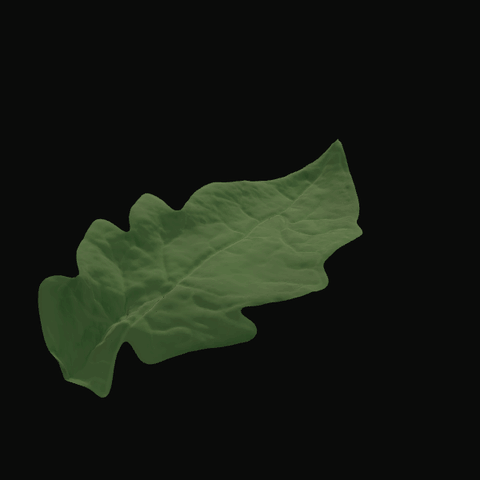
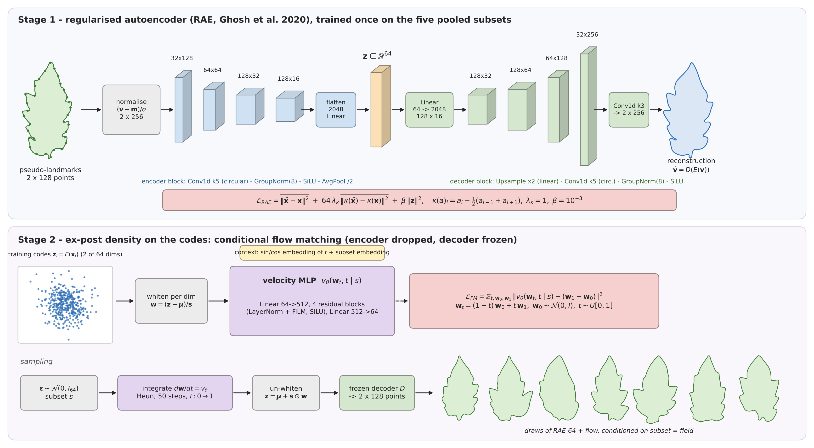
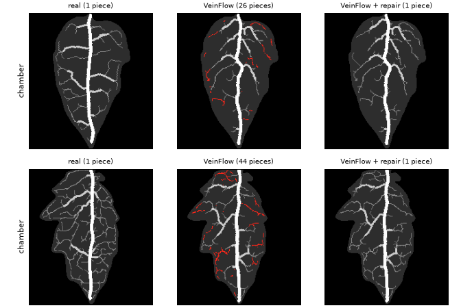
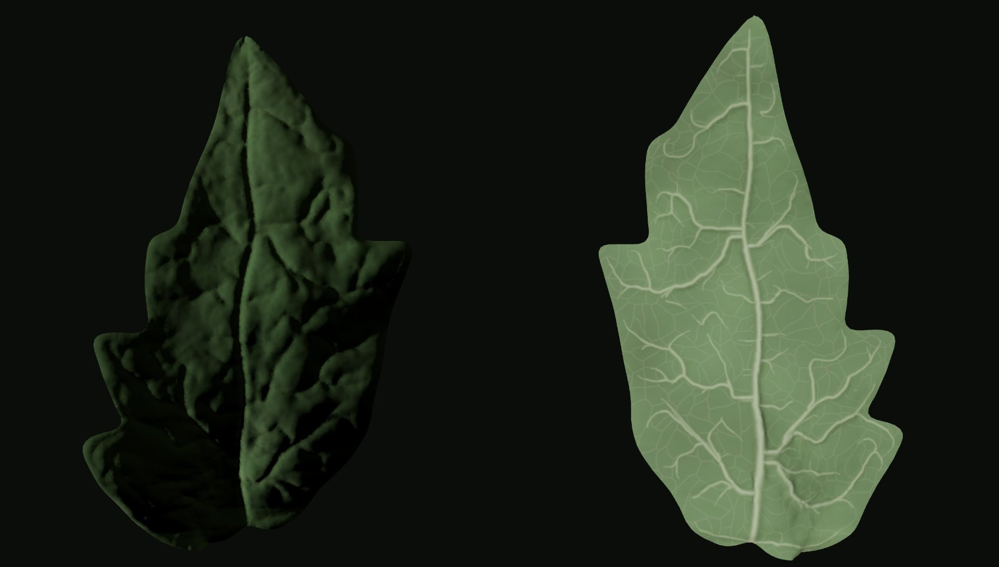
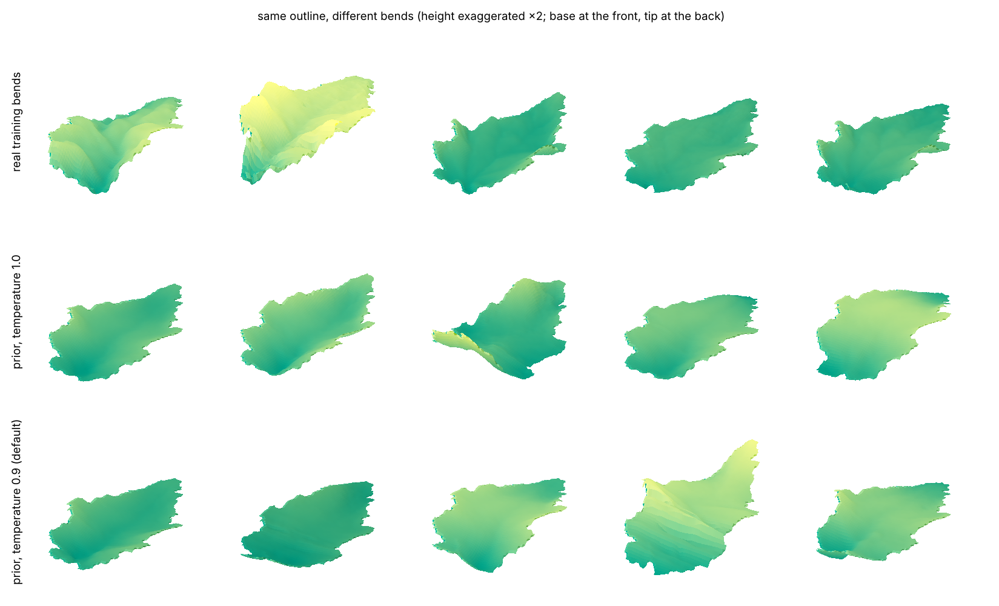

# tomato-leaf-gen

Data-driven generator of 3D tomato leaflets. Each leaflet is built in four stages: a 2D outline,
the veins drawn inside it, the surface relief that the veins leave on both sides, and a 3D bend.
Every stage is learned from real leaves: about 5,400 photos of tomato leaflets
(Chitwood et al. 2013, 2014) for outlines and veins, and 3D scans of tomato plants (Pheno4D,
Schunck et al. 2021) for the bend.



## Try it

```bash
uv sync
uv run generate.py
```

To look before installing anything, open the [interactive viewer](https://aledevv.github.io/tomato-leaf-gen/viewer/).
To generate, first put the [weights](#weights-and-data) in `weights/`. `generate.py` writes
`samples/leaf_000.obj` and the following ones (millimetres, base at the origin, tip along +y,
upper side and underside as one closed surface, albedo textures in the `.mtl`) and
`samples/viewer.html`, a 3D viewer that opens in any browser. The settings at the top of the
script choose the number of leaflets, the outline model and leaf collection, the bend spread, the
size and the mesh resolution; the defaults are the models evaluated below. One leaflet takes
about 20 s on a CPU.

## Method

**1. Outline.** The outline is a sequence of 2 × 128 pseudo-landmarks from base to tip and back.
A regularised autoencoder compresses it to 64 numbers (RAE, Ghosh et al. 2020); a flow-matching
model (Lipman et al. 2023) learns the distribution of those codes, conditioned on the leaf
collection. A second model, flow matching directly on 128 px masks with a small U-Net
(Ronneberger et al. 2015), gives outlines with more realistic margins at a lower density; it is
selectable in `generate.py`.



**2. Veins.** VeinFlow, a conditional flow-matching U-Net, draws the veins at 256 px inside the
outline mask. Its drawings break into tens of detached pieces, while every real vein network is
one tree. A repair without training fixes that: loops are cut where two paths of the drainage
tree meet, then every detached piece is joined to the main network along the cheapest path over
the drawing. The repaired drawing becomes a vein tree with flow-ranked branches.



**3. Relief.** The tree is baked into height maps of both sides: on the upper side each areole
bulges like a pillow and the veins are the creases between them; on the underside the veins stand
out as ribs, wider and higher with their order.



**4. Bend.** The bend is drawn from a prior, not predicted from the outline, which explains little
of it. Real leaflets from Pheno4D are flattened onto normalised leaf coordinates, s along the
midrib and t between the margins; their height fields are compressed by PCA to 12 whitened
components and modelled by a Gaussian mixture. A draw is evaluated at each vertex of the flat
mesh, so any outline can take any bend.



## Results

All numbers are measured on leaves the models never saw. 1-NNA is the leave-one-out accuracy of a
1-nearest-neighbour classifier separating real from generated leaves (Lopez-Paz & Oquab 2017):
0.5 means indistinguishable. Density and coverage (Naeem et al. 2020) measure fidelity and
diversity; Z_U (Meehan et al. 2020) is far below 0 when a model copies its training leaves.

**Outlines**: fresh 75/25 split by photo, evaluated once, mean of the five leaf collections.

| model | 1-NNA (0.5) | density (1) | coverage (0.97) | Z_U (0) |
| --- | --- | --- | --- | --- |
| real training leaflets | 0.50 | 1.00 | 0.97 | -48 (copies by definition) |
| RAE-64 + flow (default) | 0.59 | 0.96 | 0.93 | -2.5 |
| mask flow matching | 0.58 | 0.81 | 0.90 | 1.1 |

**Veins**: 500 held-out outlines per collection, 1-NNA, mean of the five collections. Spaces: 16
statistics of the vein image (density, gaps, orientation, orders, areoles); the same without the
vein orders; botanical characters (Ellis et al. 2009) with the vein length per area (Sack &
Scoffoni 2013); DINOv2 features (Oquab et al. 2024), as recommended by Stein et al. (2023).

| veins | 16 statistics | order-free | botanical | DINOv2 (order-free) |
| --- | --- | --- | --- | --- |
| real training leaflets | 0.50 | 0.50 | 0.50 | 0.50 |
| VeinFlow | 0.66 | 0.60 | 0.56 | 0.74 |
| VeinFlow + repair (default) | 0.59 | 0.60 | 0.54 | 0.70 |
| veins of the most similar real leaflet, moved by thin-plate spline | 0.87 | 0.88 | 0.76 | 0.76 |

**Bend**: held-out Pheno4D leaflets, measured on the height fields. Real bends do not reach 0.5
here, because the held-out set is small (101 scans of 18 leaflets); the reference is real training
bends transferred to the same outlines. Energy score: Gneiting & Raftery (2007).

| bend | 1-NNA | density | coverage | energy score |
| --- | --- | --- | --- | --- |
| real training bends, transferred | 0.74 | 0.51 | 0.67 | 0.0196 |
| PCA-12 + Gaussian mixture (default) | 0.70 | 0.68 | 0.69 | 0.0189 |

## Reproducing the tables

```bash
uv run evaluate.py --quick   # chamber only: outlines (real, RAE-64 + flow) and vein statistics
uv run evaluate.py           # outline and vein tables
```

The splits are fixed (`splits/` lists the photos on each side), the library versions are those
of the experiments (`pyproject.toml`, `uv.lock`), and every row is printed next to its published
value (`expected/`). Vein rows reproduce exactly from the drawings in the data archive. Outline
rows are drawn again and the random stream depends on the device: on a CPU, RAE-64 + flow on
chamber gives 1-NNA 0.575 against the published 0.591 (drawn on a GPU); the real row is exact. The bend table
needs the Pheno4D scans, which are not redistributed here. Training: [docs/reproduce.md](docs/reproduce.md).

## Weights and data

Both are attached to the [v0.1.0 release](../../releases/tag/v0.1.0); unzip them at the
repository root.

- `weights.zip` (92 MB): RAE-64, its flow, the mask model, VeinFlow and the bend prior.
- `data.zip` (181 MB): outlines (elliptic Fourier coefficients) and vein rasters of the evaluation
  splits, and the VeinFlow drawings of the vein table; needed only by `evaluate.py`.

`SHA256SUMS` lists their checksums. Outlines and veins derive from the tomato leaf scans of
Chitwood ([Zenodo, CC BY 4.0](https://zenodo.org/records/19656245)) and the bend prior from
[Pheno4D](https://www.ipb.uni-bonn.de/data/pheno4d/): cite them as below when you use these files.

## References

- Chitwood et al. A quantitative genetic basis for leaf morphology in a set of precisely defined tomato introgression lines. *The Plant Cell*, 2013.
- Chitwood et al. Resolving distinct genetic regulators of tomato leaf shape within a heteroblastic and ontogenetic context. *The Plant Cell*, 2014.
- Schunck et al. Pheno4D: a spatio-temporal dataset of maize and tomato plant point clouds for phenotyping and advanced plant analysis. *PLOS ONE*, 2021.
- Ghosh et al. From variational to deterministic autoencoders. *ICLR*, 2020.
- Lipman et al. Flow matching for generative modeling. *ICLR*, 2023.
- Ronneberger et al. U-Net: convolutional networks for biomedical image segmentation. *MICCAI*, 2015.
- Ellis et al. *Manual of Leaf Architecture*. Cornell University Press, 2009.
- Sack & Scoffoni. Leaf venation: structure, function, development, evolution, ecology and applications in the past, present and future. *New Phytologist*, 2013.
- Naeem et al. Reliable fidelity and diversity metrics for generative models. *ICML*, 2020.
- Lopez-Paz & Oquab. Revisiting classifier two-sample tests. *ICLR*, 2017.
- Meehan et al. A non-parametric test to detect data-copying in generative models. *AISTATS*, 2020.
- Oquab et al. DINOv2: learning robust visual features without supervision. *TMLR*, 2024.
- Stein et al. Exposing flaws of generative model evaluation metrics and their unfair treatment of diffusion models. *NeurIPS*, 2023.
- Gneiting & Raftery. Strictly proper scoring rules, prediction, and estimation. *JASA*, 2007.

## Licence

Code: MIT. If you use this generator, please cite this repository (`CITATION.cff`) and the
datasets above.
